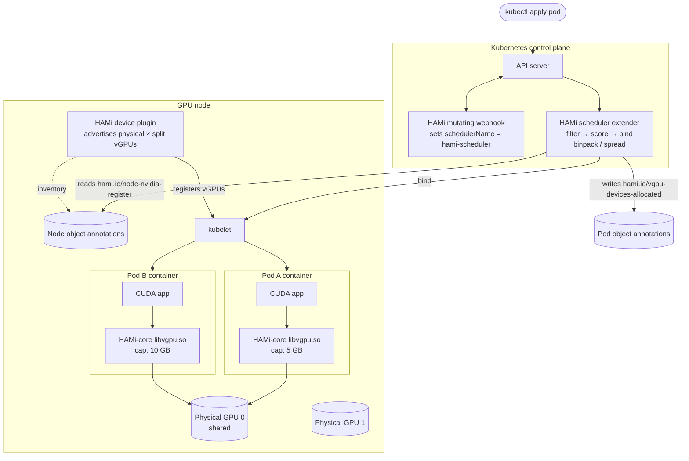
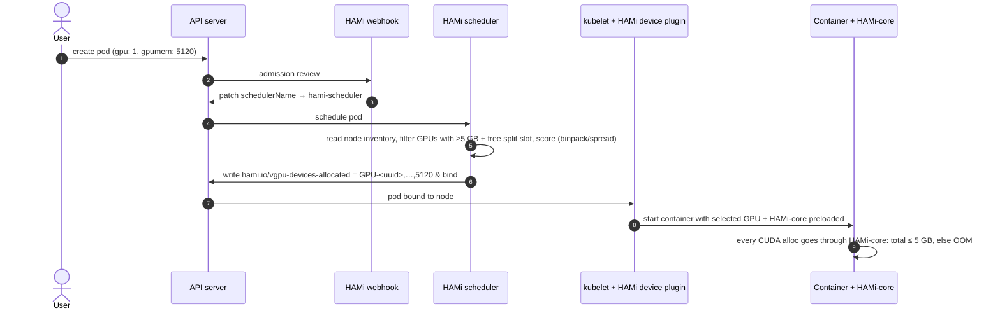

# 03 — Introduction to HAMi & Its Architecture

---

## 1. What is HAMi?

**HAMi**, the *Heterogeneous AI Computing Virtualization Middleware* (formerly *k8s-vGPU-scheduler*), is an open-source **CNCF Sandbox** project. It provides GPU (and other accelerator) virtualization and sharing for Kubernetes.

It inserts a **virtualization layer** between Kubernetes and the hardware. Instead of exposing *1 GPU = 1 unit*, it exposes each physical GPU as **multiple virtual GPUs**, each limited to a specific slice of memory and compute.

### What HAMi provides

| Capability | Meaning |
|---|---|
| **Fine-grained sharing** | Split one physical GPU into many vGPUs, each limited by memory (MiB or %) and compute (%). |
| **Hard isolation** | A container sees and can use only what it was granted. Going over the memory quota causes an OOM error **in that pod only**. |
| **Whole-device allocation** | One or more full GPUs can still go to a single pod (e.g. large-model training). |
| **Device-aware scheduling** | A scheduler extender places pods based on real GPU inventory, using **binpack** (consolidate) or **spread** (distribute). |
| **Multi-tenant quotas** | Per-namespace limits on GPU count and GPU memory. |
| **Heterogeneous hardware** | Besides NVIDIA: AMD, Cambricon, Hygon, Iluvatar, MThreads, Ascend and others, under one model. |
| **Transparent to applications** | No code changes, no custom CUDA build, no special image. Workloads keep using `nvidia.com/...` resource requests. |

---

## 2. Resource fields

Workloads keep using standard Kubernetes resource requests and gain new, finer-grained fields:

| Field | Unit | Meaning |
|---|---|---|
| `nvidia.com/gpu` | count | Number of **physical** GPUs the pod needs |
| `nvidia.com/gpumem` | MiB | Memory slice **per physical GPU** (1 GB = 1024 MiB) |
| `nvidia.com/gpumem-percentage` | % | Memory slice as a percentage of each card |
| `nvidia.com/gpucores` | % | Compute cap, as a percentage of the card |
| `hami.io/gpu-scheduler-policy` (annotation) | `binpack` / `spread` | How pods are placed across GPUs |
| `hami.io/node-scheduler-policy` (annotation) | `binpack` / `spread` | How pods are placed across nodes |

### The two semantics everyone gets wrong

1. **On the node**, after HAMi is installed, `nvidia.com/gpu` capacity = **physical GPUs × split count** (default split = 10, so 4 GPUs show as 40).
   **In a pod request**, `nvidia.com/gpu` still means **physical GPUs**. `nvidia.com/gpu: 2` = two *different* cards.

2. `gpumem` is applied **per card**, not shared as a pool:
   `nvidia.com/gpu: 2` + `gpumem: 20480` = 20 GB on **each** of 2 cards = **40 GB total**.

> Overcommit is a *logical* scheduling view to increase utilisation. It does **not** create extra physical memory. A pod can never use more than the card it lands on actually has.

---

## 3. Components

HAMi is built from components that span the **Kubernetes control plane**, **each GPU node**, and **the inside of every GPU workload container**.

| Component | Runs where | Responsibility |
|---|---|---|
| **Mutating admission webhook** | Control plane | Intercepts GPU pod creation and sends the pod to the HAMi scheduler instead of the default one. |
| **Scheduler extender** (`hami-scheduler`) | Control plane | Filters and scores nodes/GPUs based on real GPU inventory, picks a physical GPU that fits, and writes the chosen device UUID into the pod's annotations at bind time. |
| **HAMi device plugin** (`hami-device-plugin`) | Each GPU node (DaemonSet) | Registers **virtual** GPU resources (`nvidia.com/gpu`, `gpumem`, `gpucores`) with the kubelet. Advertised count = physical GPUs × split count. |
| **HAMi-core** (`libvgpu.so`) | Inside each workload container | Intercepts CUDA/NVML API calls (preloaded into the container) and enforces the per-pod memory and compute limits, so the container sees only its slice. |
| **Node inventory annotation** | Each GPU node object | `hami.io/node-nvidia-register` holds each GPU's UUID, index, split count, memory and compute. This is the data the scheduler reads. |
| **Pod allocation annotation** | Each GPU pod object | `hami.io/vgpu-devices-allocated` holds the physical GPU UUID(s) and the slice granted. **This is how the test cases check where a pod landed.** |

---

## 4. Architecture diagram



<details>
<summary>Text version of the diagram (for terminals and slides)</summary>

```
                        ┌───────────────────────────────────────────────┐
                        │           Kubernetes Control Plane            │
   kubectl apply pod    │   ┌───────────────┐      ┌─────────────────┐  │
   ──────────────────►  │   │  API Server   │─────►│ HAMi Mutating   │  │
                        │   │               │◄─────│ Webhook         │  │
                        │   └──────┬────────┘      └─────────────────┘  │
                        │          ▼                                    │
                        │   ┌─────────────────────┐  reads node GPU     │
                        │   │ HAMi Scheduler      │  inventory, picks   │
                        │   │ Extender            │  a physical GPU,    │
                        │   │ (filter+score+bind) │  writes UUID to pod │
                        │   └──────────┬──────────┘  annotation         │
                        └──────────────┼────────────────────────────────┘
                                       ▼ bind
        ┌──────────────────────────────────────────────────────────┐
        │                       GPU Node                           │
        │   ┌──────────────┐        ┌──────────────────────────┐   │
        │   │  kubelet     │◄───────│ HAMi Device Plugin       │   │
        │   │              │        │ (vGPUs = physical×split) │   │
        │   └──────┬───────┘        └──────────────────────────┘   │
        │          ▼ starts container                              │
        │   ┌──────────────────────────────────────────────────┐   │
        │   │ Workload container                               │   │
        │   │   Application (CUDA)                             │   │
        │   │        │ CUDA API calls                          │   │
        │   │        ▼                                         │   │
        │   │   HAMi-core (libvgpu.so) → enforces mem/compute  │   │
        │   └────────┼─────────────────────────────────────────┘   │
        │            ▼                                             │
        │     ┌─────────────┐   ┌─────────────┐   ...              │
        │     │Physical GPU │   │Physical GPU │                    │
        │     │(shared)     │   │             │                    │
        │     └─────────────┘   └─────────────┘                    │
        └──────────────────────────────────────────────────────────┘
        Node annotation: hami.io/node-nvidia-register
        (per-GPU UUID, index, split count, devmem, devcore)
```
</details>

---

## 5. What happens when you submit a GPU pod



1. **Submit**: the user applies a pod requesting `nvidia.com/gpu: 1`, `nvidia.com/gpumem: 5120`.
2. **Webhook**: HAMi's mutating webhook sets the pod's `schedulerName` to the HAMi scheduler.
3. **Schedule**: the extender reads each node's `hami.io/node-nvidia-register` inventory, filters to GPUs with 5 GB free and a free split slot, then scores them (binpack/spread).
4. **Bind**: it writes the chosen physical GPU UUID into `hami.io/vgpu-devices-allocated` and binds the pod.
5. **Device plugin**: the node's HAMi device plugin gives the container access to that physical GPU.
6. **Inject**: HAMi-core (`libvgpu.so`) is loaded into the container.
7. **Enforce**: every CUDA call passes through HAMi-core. The container sees 5 GB, allocations beyond 5 GB fail, and neighbours on the same card are unaffected.

---

## 6. Design principles

| Principle | Why it matters |
|---|---|
| **Decide centrally, enforce locally** | Scheduling decisions happen in the control plane (webhook + extender). Enforcement happens inside each container (HAMi-core). The scheduler stays simple, and isolation stays close to the workload. |
| **Annotation-driven state** | Inventory and allocations are plain Kubernetes annotations. Everything can be inspected with `kubectl`, with no hidden database. That's what makes every test case in [06](06-test-cases.md) checkable. |
| **API-level interception, not hardware partitioning** | Isolation comes from intercepting CUDA calls, not from silicon partitioning. That's why it works on cards **without MIG** support. The trade-off: enforcement is software-based (see [07 — Conclusion](07-conclusion.md)). |

**Next:** [04 — My scaling issue](04-my-scaling-issue.md)
